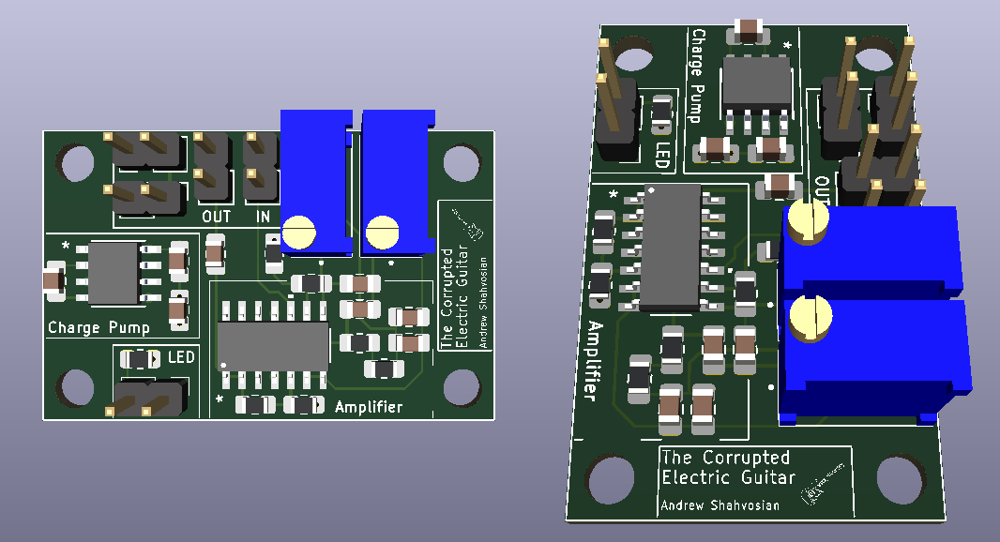
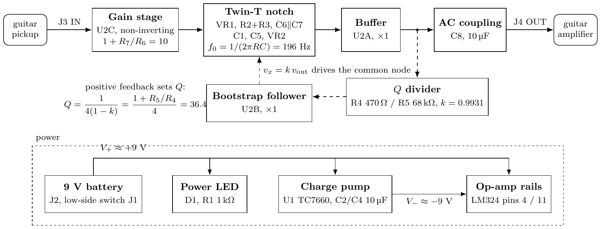
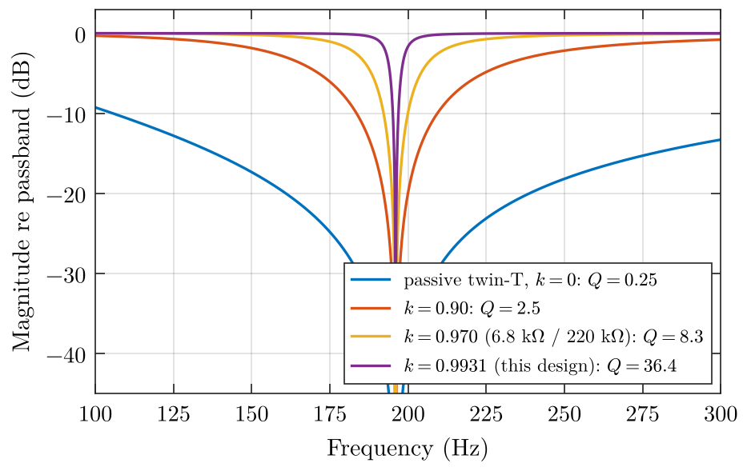
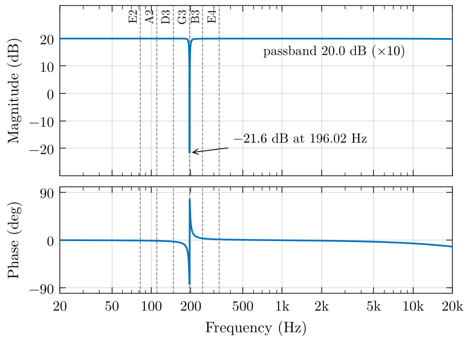
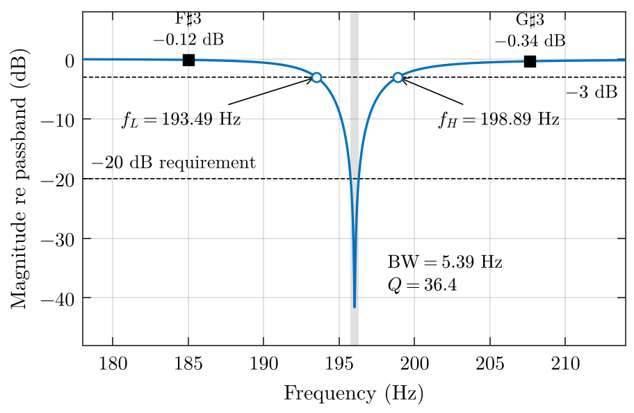
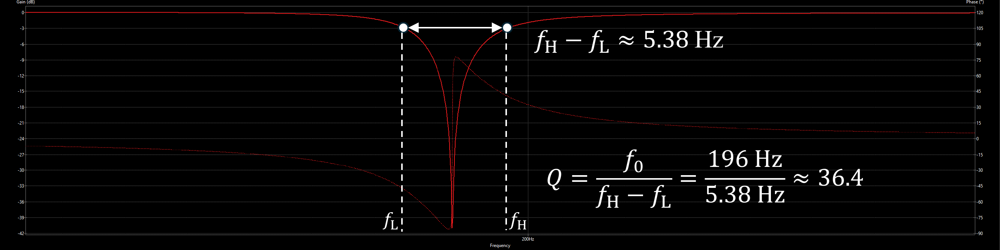
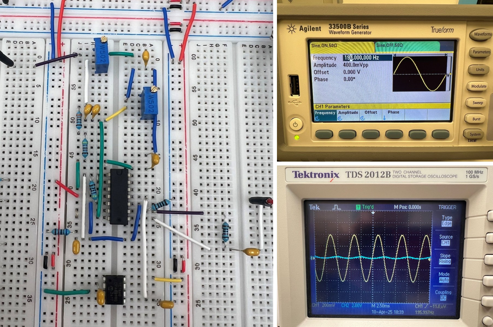
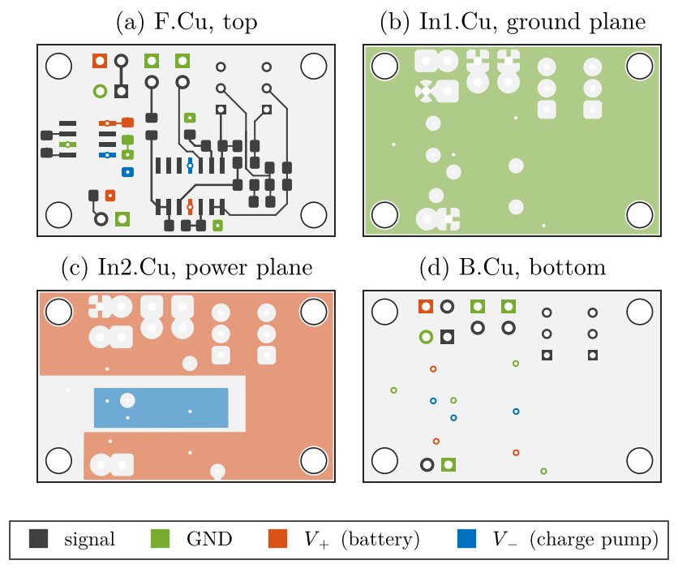
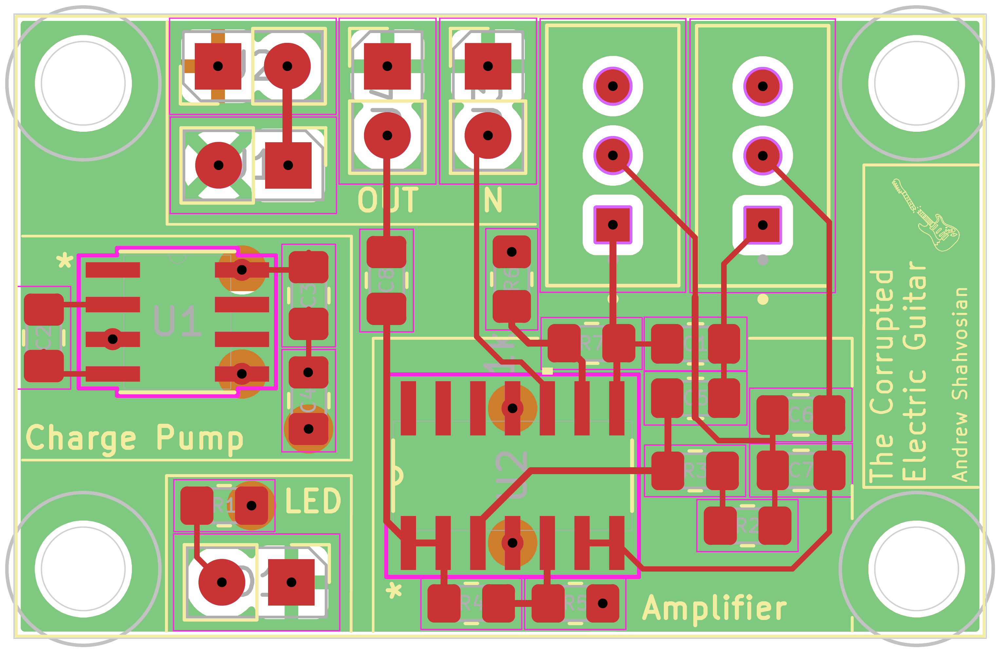
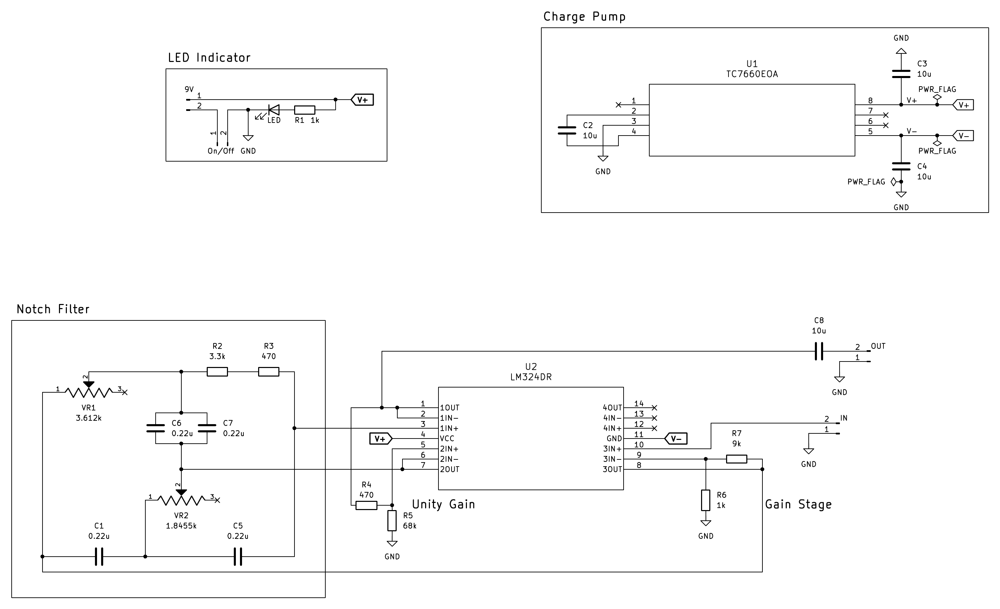

# The Corrupted Chord Electric Guitar

**An active twin-T notch filter that removes the open-G fundamental from an electric guitar.**



The module sits between a guitar's pickup and its amplifier and removes **196.00 Hz**, the fundamental of the open G string (G3). Every other note passes through almost unchanged. A G played in a chord loses its fundamental but keeps its harmonics, so the chord sounds subtly "corrupted".

The circuit uses one LM324 quad op-amp and a 9 V battery, and it fits on a **1.4 × 0.9 in four-layer PCB** designed in KiCad 10.

📄 **[Read the design report (PDF)](report/corrupted_chord_report.pdf)**: circuit design, analysis, PCB layout and prototype verification.

> **Status:** the circuit has been verified on a breadboard prototype, which cut a 196 Hz tone by about 29 dB, and the four-layer PCB layout is complete. The numbers below are predictions from a circuit model built directly from the board's own netlist; a KiCad SPICE simulation of the schematic agrees with them. Bench measurements of the assembled PCB will be added after assembly.

## At a glance

| | Result (model predictions unless marked measured) |
|---|---|
| Notch | −41.6 dB at 196.02 Hz; the open G (196.00 Hz) is cut by **38.8 dB** (spec: ≥ 20 dB) |
| Breadboard prototype (measured) | about **29 dB** of suppression at 196 Hz, read from the scope capture below |
| Quality factor | **Q = 36.4**, −3 dB bandwidth 5.39 Hz (193.49–198.89 Hz) |
| Neighbouring notes | −0.12 dB at F♯3 (185.00 Hz), −0.34 dB at G♯3 (207.65 Hz) |
| Passband | +20 dB (×10), flat to ±0.03 dB from 20 Hz to 5 kHz |
| Power | 9 V battery; TC7660 charge pump makes the −9 V rail |
| Board | 35.56 × 22.86 mm, four layers: signal, GND plane, split ±9 V plane, bottom |

## How it works



1. **Gain stage.** U2C is a non-inverting amplifier with a gain of $1 + R_7/R_6 = 1 + 9\,\text{k}/1\,\text{k} = 10$.
2. **Twin-T network.** A resistive T ($R$, $R$, $2C$) and a capacitive T ($C$, $C$, $R/2$) in parallel cancel each other at
   $f_0 = 1/(2\pi RC)$. With $C = 0.22\,\mu\text{F}$, a null at 196 Hz needs $R = 3.691\,\text{k}\Omega$. This is built from 3.3 kΩ + 470 Ω in one arm and a trimmer set to 3.612 kΩ in the other (VR1), with a second trimmer setting $R/2 = 1.8455\,\text{k}\Omega$ (VR2).
3. **Bootstrap.** On its own, a twin-T has $Q = 1/4$, which would cut almost an octave around 196 Hz. Buffer U2A, the divider R4/R5 and follower U2B instead drive the network's common node with $k = R_5/(R_4+R_5) = 0.9931$ of the output:

$$H(s) = \frac{T}{1-k+kT} = \frac{s^2+\omega_0^2}{s^2+4(1-k)\,\omega_0 s+\omega_0^2}, \qquad Q = \frac{1}{4(1-k)} = \frac{1}{4}\left(1+\frac{R_5}{R_4}\right) = 36.4$$



## Predicted response




The KiCad SPICE simulation of the same schematic gives the same −3 dB bandwidth (about 5.38 Hz) and Q (about 36.4), with a minimum near −41 dB:



## Breadboard prototype

The circuit was prototyped on a breadboard with DIP versions of the LM324 and TC7660 and the same 3296W trimmers. A 196.000 Hz sine (400 mVpp setting, about 0.8 Vpp at the high-impedance input) leaves the output almost flat at 2 V/div. Fitting a 196 Hz sinusoid to the output trace gives about 0.27 Vpp, against roughly 8 Vpp without the notch. That is about **29 dB** of suppression from a single-frequency check, comfortably past the 20 dB requirement.



## PCB

As a design challenge, every component sits on one side of the board. The layout keeps trace lengths as short as possible while putting everything that is touched after assembly, the two trimmers and the headers for the jacks, battery, switch and LED, on that same side.

- 4 layers, 1.6 mm FR-4: F.Cu (all routing), In1.Cu (solid GND), In2.Cu (V+ pours around a V− island), B.Cu (no routing)
- all 24 parts on the top side: 0805 passives, SOIC-14 LM324, SOIC-8 TC7660, two Bourns 3296W 25-turn trimmers and 2.54 mm headers
- 82 track segments (127 mm total) and 10 vias connecting the supply pins to the planes




## Schematic



A vector copy is in [`hardware/exports/schematic.pdf`](hardware/exports/schematic.pdf).

## Repository layout

```
├── analysis/            Python model and figure scripts (values read straight from the .kicad_pcb)
│   ├── kicad_parse.py   minimal KiCad S-expression reader: footprints, values, pad nets
│   ├── model.py         nodal analysis (LM324 model) + ideal-buffer model of the twin-T
│   ├── figures.py       response and bootstrapping figures -> results.json
│   └── render_layers.py copper-layer renders from the board file
├── hardware/            KiCad 10 project: schematic, 4-layer PCB, PDF exports
├── images/              README graphics
└── report/              design report: PDF, LaTeX source and figures
```
